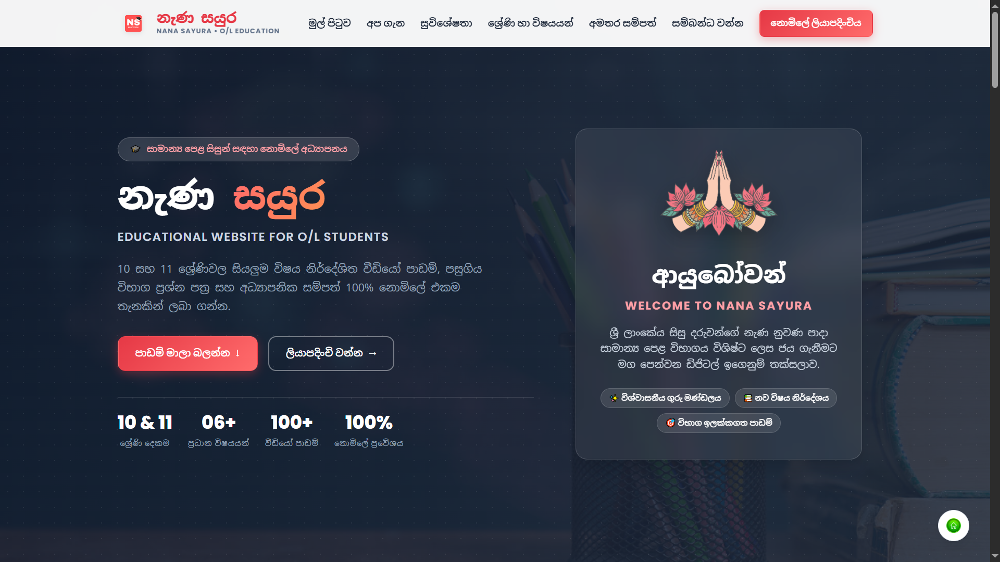

# නැණ සයුර - O/L Educational Website

Educational Website for Grade 10 & 11 Sinhala Medium Students. Built with pure HTML & CSS.

## 🔗 Live Demo
👉 https://yasintha-madhusanka.github.io/nana-sayura-education/

## ✨ Features
- Modern Dark UI with Glassmorphism
- Fully Responsive Design
- Sinhala Language Optimized
- 6 Subjects Pages (Sinhala, Math, Science, etc.)
- 100% Free Education

## 🛠️ Built With
- HTML5
- CSS3 (Flexbox, Grid)

## 👨‍💻 Author
Yasintha Madhusanka - HNDIT Student

### How to run
Just open `index.html`
